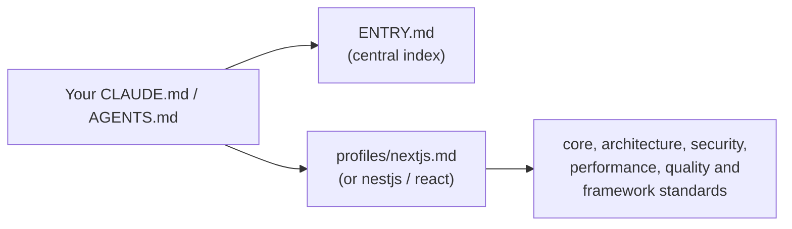

# NSES — NewAgeSysIT Engineering Standards

**Version:** 1.3.0  
**Status:** Initial baseline  
**Distribution:** Git submodule  
**Supported stacks:** Next.js, NestJS, React (TypeScript / Node.js)

NSES is one shared set of engineering rules for every NewAgeSysIT project. It covers how we write, structure, secure, test and review code.

You add NSES to your project once. After that:

- **Developers** have one place to look up "how do we do this here?"
- **AI coding assistants** such as Claude Code, Codex, Cursor and Copilot read the same rules automatically, so the code they write follows company standards.
- **CI** can check that the project is wired up correctly.

NSES does not replace framework documentation, security review or engineering judgement. It is the baseline every project starts from.

---

## Contents

1. [How it works](#1-how-it-works)
2. [Choose your profile](#2-choose-your-profile)
3. [Add NSES to a new project](#3-add-nses-to-a-new-project)
4. [Add NSES to an existing project](#4-add-nses-to-an-existing-project)
5. [Ready-to-paste CLAUDE.md and AGENTS.md](#5-ready-to-paste-claudemd-and-agentsmd)
6. [Check your setup](#6-check-your-setup)
7. [Use the shared tooling (optional)](#7-use-the-shared-tooling-optional)
8. [Update to a newer NSES version](#8-update-to-a-newer-nses-version)
9. [Troubleshooting](#9-troubleshooting)
10. [What is in this repository](#10-what-is-in-this-repository)
11. [For NSES maintainers](#11-for-nses-maintainers)

---

## 1. How it works

NSES lives in its own Git repository. Your project includes it as a **Git submodule**: a pinned copy of this repository inside a folder of your project, by convention `.engineering/standards`.

```text
your-project/
├── .engineering/
│   └── standards/        ← NSES (this repository, pinned to a release such as v1.3.0)
├── CLAUDE.md             ← tells Claude Code to load NSES
├── AGENTS.md             ← tells other AI agents to read NSES
├── package.json
└── src/
```

Your two instruction files point the AI assistant at NSES, and NSES then points it at the right rules:



- [ENTRY.md](ENTRY.md) is the front door. It explains the rule levels and the workflow every task must follow.
- A **profile** (in [profiles/](profiles/)) is a reading list for one technology. It pulls in exactly the standards that apply to that stack, so the assistant does not load unrelated rules.

> **Important:** a submodule is just files on disk. Nothing is loaded automatically. NSES only takes effect once your `CLAUDE.md` and `AGENTS.md` reference it, as shown in [section 5](#5-ready-to-paste-claudemd-and-agentsmd).

### What the rule words mean

| Word | Meaning |
| --- | --- |
| **MUST** | Required. A violation blocks the merge unless an approved, time-limited exception exists. |
| **SHOULD** | The expected default. If you deviate, write down why in the PR or design note. |
| **MAY** | Optional. Use it when it solves a real problem. |

### Our principles

1. Secure by default; trust boundaries are explicit.
2. Prefer simple, readable, maintainable solutions over clever abstractions.
3. Keep responsibilities separated and dependencies flowing inward.
4. Run trusted operations on the server; browser code only receives data it is allowed to see.
5. Validate at boundaries and authorize every protected operation.
6. Automate deterministic checks; use humans for context and trade-offs.
7. Improve existing code incrementally; do not introduce unrelated rewrites.

---

## 2. Choose your profile

Pick the profile that matches what your project is built with. The compliance checker detects this from your `package.json`.

| Your project is… | Use this profile | Detected when `package.json` has |
| --- | --- | --- |
| A **Next.js** web app | [profiles/nextjs.md](profiles/nextjs.md) | `next` |
| A **NestJS** API or backend service | [profiles/nestjs.md](profiles/nestjs.md) | `@nestjs/core` |
| A **React** app *without* Next.js (for example Vite) | [profiles/react.md](profiles/react.md) | `react`, but not `next` |

- A Next.js app uses **only** the Next.js profile. It already includes the React rules.
- A repository with more than one stack (for example a Next.js frontend and a NestJS API in one monorepo) uses one profile per stack. See the [monorepo example](#monorepo-nextjs--nestjs).
- **Other languages and frameworks** (Python, Java, .NET, Flutter and so on) do not have a profile yet. You can still use the language-neutral standards in [core/](core/), [security/](security/) and [quality/](quality/). Ask the NSES maintainers before inventing a local profile.

---

## 3. Add NSES to a new project

Use this when you are starting a project from scratch. It takes about 10 minutes.

**You need:** Git, Node.js 22 or later, and read access to this GitHub repository.

### Step 1 — Add the submodule

Run this from your project's root folder:

```bash
git submodule add https://github.com/NewAgeSMB-Team4/newagesysit-engineering-standards.git .engineering/standards
cd .engineering/standards
git checkout v1.3.0
cd ../..
```

This downloads NSES into `.engineering/standards` and pins it to release `v1.3.0`. Always pin a release tag. Never follow `main`, because it can change under you.

### Step 2 — Add the AI instruction files

Create two files in your project root:

- `CLAUDE.md`, for Claude Code
- `AGENTS.md`, for Codex, Cursor, Copilot, Gemini and other agents

Copy the version for your stack from [section 5](#5-ready-to-paste-claudemd-and-agentsmd). Then fill in the `TODO` parts: what the project is, how to run it, and anything unusual about it.

### Step 3 — Protect secrets

Two things keep secrets safe. First, your `.gitignore` should contain these lines, so environment files never reach Git:

```gitignore
.env
.env.*
!.env.example
```

Second, **block AI assistants from reading secret files**. Instructions alone only *ask* the assistant not to look; a deny list makes it impossible. Copy the NSES template into your project:

```bash
mkdir -p .claude
cp .engineering/standards/ai-instructions/claude-settings.json .claude/settings.json
```

That covers Claude Code. If your team also uses Cursor, Copilot, Codex, Gemini CLI or Windsurf, set each one up too; see [Block AI access to secrets](#block-ai-access-to-secrets).

### Step 4 — (Optional) Use the shared tooling

Use the NSES ESLint, TypeScript and Prettier settings so that your linter enforces the same rules the documents describe. See [section 7](#7-use-the-shared-tooling-optional).

### Step 5 — Check and commit

```bash
node .engineering/standards/scripts/check-project-compliance.js .
```

Fix any `FAIL` lines (see [section 6](#6-check-your-setup)), then commit:

```bash
git add .gitmodules .engineering/standards CLAUDE.md AGENTS.md .gitignore .claude/settings.json
git commit -m "chore: adopt NSES v1.3.0"
```

### Step 6 — Tell your team about cloning

Anyone who clones the project must also download the submodule, otherwise the `.engineering/standards` folder will be empty:

```bash
git clone --recurse-submodules <your-project-url>
# or, if already cloned:
git submodule update --init
```

It helps to add this to your project's own `README.md`.

---

## 4. Add NSES to an existing project

The setup steps are the same as for a new project. The difference is **how strictly you apply the rules**, because existing code was not written against NSES.

### Step 1 — Add NSES and the instruction files

Follow steps 1–3 of [section 3](#3-add-nses-to-a-new-project).

**If you already have a `CLAUDE.md` or `AGENTS.md`**, do not overwrite it. Keep your existing content and add the NSES block from [section 5](#5-ready-to-paste-claudemd-and-agentsmd) near the top. Delete any old rules that NSES now covers, and keep project-specific notes.

**If you already have a `.claude/settings.json`**, do not overwrite it either. Merge the `permissions.deny` entries from [ai-instructions/claude-settings.json](ai-instructions/claude-settings.json) into your existing `permissions.deny` list.

**Check that no secret has already been committed.** Old projects sometimes have a key buried in Git history. Run the [secret scan](#scan-for-leaked-secrets-gitleaks) once over the whole history; if it finds a real secret, **rotate it** (deleting the file is not enough, because it stays in history).

### Step 2 — Run the checker in report-only mode

```bash
node .engineering/standards/scripts/check-project-compliance.js . --report
```

`--report` never fails. It gives you a to-do list of what is missing without blocking anything.

### Step 3 — Apply the rules to new work first

- **New and changed code** must follow the MUST rules from day one.
- **Old code** does not have to be rewritten in one go. Fix it when you touch it, or plan the cleanup as separate tickets.
- **Security, privacy and access-control rules always apply**, even to legacy code. If something cannot be fixed yet, record an approved exception using [templates/exception-request.md](templates/exception-request.md), with an owner and an expiry date.
- Do not mix large formatting or lint clean-ups into feature PRs. Do them in a dedicated PR.

The AI assistant follows the same approach: [ENTRY.md](ENTRY.md) tells it to make the smallest coherent change and to avoid unrelated rewrites.

### Step 4 — Turn on the tooling gradually

1. Add the NSES ESLint and Prettier configs. Expect many warnings in old code; that is normal.
2. Enable strict TypeScript. For a large codebase you can temporarily set `noUncheckedIndexedAccess` to `false` in your own `tsconfig.json` and plan the migration.
3. Add the NSES check to CI in report-only mode (see [section 6](#6-check-your-setup)).
4. Once the checker is clean, remove `--report` so that regressions block merges.

The full checklist is in [adoption/project-onboarding.md](adoption/project-onboarding.md), and the rollout plan is in [adoption/implementation-roadmap.md](adoption/implementation-roadmap.md).

> Adding NSES to `CLAUDE.md` does not make a project compliant. Compliance comes from passing CI checks (lint, typecheck, tests, security scans) and human review.

---

## 5. Ready-to-paste CLAUDE.md and AGENTS.md

Each stack below has both files. Copy them into your **project root** and replace every `TODO`.

**Why two files?**

- **`CLAUDE.md`** is read by Claude Code. Lines starting with `@` are **imports**: Claude Code loads those files (and the files they import) into its context automatically.
- **`AGENTS.md`** is the open standard read by Codex, Cursor, GitHub Copilot, Gemini CLI and others. These tools do not understand `@` imports, so the file tells the agent in plain words which files to read.

**Rules that make the imports work:**

- In `CLAUDE.md`, write `@` imports on their own line and **outside** code blocks. Imports inside ``` blocks are ignored.
- Import **one** `ENTRY.md` and **only** the profile(s) your project uses. Importing every profile wastes the assistant's context.
- Paths are relative to the file. If you mounted NSES somewhere other than `.engineering/standards`, change every path.
- Keep project-specific facts (commands, architecture, exceptions) in your own file. Do not copy NSES rules into it.

The generic templates these are based on are in [ai-instructions/](ai-instructions/).

### Next.js

<details>
<summary><b>CLAUDE.md</b> — Next.js</summary>

```markdown
# Claude Code project instructions

This project follows NewAgeSysIT Engineering Standards (NSES), pinned as a Git submodule at `.engineering/standards`.

## Standards

@.engineering/standards/ENTRY.md
@.engineering/standards/profiles/nextjs.md

Also follow `AGENTS.md` and any more specific instructions in the directories you change.

## About this project

- **What it is:** TODO — one or two sentences on what the app does and who uses it.
- **Stack:** Next.js TODO-version (App Router), React TODO-version, TypeScript, TODO (database / ORM / auth provider / UI library).
- **Package manager:** TODO (npm / pnpm / yarn).

## Commands

- Install: `npm ci`
- Dev server: `npm run dev`
- Lint: `npm run lint`
- Typecheck: `npm run typecheck`
- Tests: `npm test`
- Build: `npm run build`

## Architecture notes

- TODO — where things live, for example: routes in `app/`, shared UI in `components/`, server-only data access in `lib/server/`.
- TODO — the authentication and authorization approach, and where it is enforced.
- TODO — any data classified as sensitive (personal data, payments, health data and so on).

## Approved exceptions

- None. (List NSES exceptions here with owner, reason and expiry date.)

## Working rules

- Prefer Server Components; add `"use client"` only where interactivity or browser APIs are needed.
- Validate input and check authorization on the server in every Server Action and Route Handler.
- Never read, print or commit `.env` values or other secrets.
- Before finishing, review the diff, run lint, typecheck and tests, and report exactly what was and was not verified. Never claim a check passed unless you ran it.
```

</details>

<details>
<summary><b>AGENTS.md</b> — Next.js</summary>

```markdown
# Engineering agent instructions

You are working in a NewAgeSysIT Next.js application. Follow this file and the pinned NSES standards in `.engineering/standards`.

## Standards to read before every task

1. `.engineering/standards/ENTRY.md` — rule levels and the mandatory task workflow.
2. `.engineering/standards/profiles/nextjs.md` — the Next.js profile. Read every standard it lists.

Do not load the NestJS or standalone React profiles; they do not apply to this project.

## About this project

- **What it is:** TODO
- **Stack:** Next.js TODO-version, React TODO-version, TypeScript, TODO
- **Commands:** install `npm ci` · dev `npm run dev` · lint `npm run lint` · typecheck `npm run typecheck` · test `npm test` · build `npm run build`
- **Architecture:** TODO

## Mandatory workflow

1. Inspect the structure, package scripts, installed framework versions and relevant tests before editing.
2. For non-trivial changes, state a short plan and any security, data or performance impact first.
3. Make the smallest coherent change. Keep existing conventions; no unrelated refactors.
4. Validate untrusted input at boundaries and authorize protected operations on the server.
5. Add or update tests for behavior and important failure paths.
6. Run lint, typecheck, tests and build. Never claim a check passed unless you ran it.
7. Report changed files, decisions, commands run with their results, and remaining risks.

## Security

- Never read, print, copy or commit `.env` values, credentials, tokens, keys or production data.
- Do not weaken authentication, authorization, validation, CSP, CORS or rate limits to make a task pass.
- Do not run destructive commands, production migrations or deployments without explicit approval.
- Keep secrets and privileged data access on the server; never expose them to Client Components.
```

</details>

### NestJS

<details>
<summary><b>CLAUDE.md</b> — NestJS</summary>

```markdown
# Claude Code project instructions

This project follows NewAgeSysIT Engineering Standards (NSES), pinned as a Git submodule at `.engineering/standards`.

## Standards

@.engineering/standards/ENTRY.md
@.engineering/standards/profiles/nestjs.md

Also follow `AGENTS.md` and any more specific instructions in the directories you change.

## About this project

- **What it is:** TODO — one or two sentences on what the service does and who calls it.
- **Stack:** NestJS TODO-version, Node.js TODO-version, TypeScript, TODO (database / ORM such as Prisma or TypeORM / queue / auth).
- **Package manager:** TODO (npm / pnpm / yarn).

## Commands

- Install: `npm ci`
- Start (watch): `npm run start:dev`
- Lint: `npm run lint`
- Typecheck: `npm run typecheck`
- Unit tests: `npm test`
- E2E tests: `npm run test:e2e`
- Build: `npm run build`
- Migrations: TODO (never run against production without approval)

## Architecture notes

- TODO — module layout, for example one feature module per domain under `src/modules/`.
- TODO — how authentication and authorization work (guards, roles, policies).
- TODO — external integrations and sensitive data handled by this service.

## Approved exceptions

- None. (List NSES exceptions here with owner, reason and expiry date.)

## Working rules

- Validate every request with DTOs and the global ValidationPipe; never trust client input.
- Protect every non-public endpoint with a guard and check authorization server-side.
- Use the Nest `Logger`, not `console`; never log secrets or personal data.
- Never read, print or commit `.env` values or other secrets.
- Before finishing, review the diff, run lint, typecheck and tests, and report exactly what was and was not verified. Never claim a check passed unless you ran it.
```

</details>

<details>
<summary><b>AGENTS.md</b> — NestJS</summary>

```markdown
# Engineering agent instructions

You are working in a NewAgeSysIT NestJS service. Follow this file and the pinned NSES standards in `.engineering/standards`.

## Standards to read before every task

1. `.engineering/standards/ENTRY.md` — rule levels and the mandatory task workflow.
2. `.engineering/standards/profiles/nestjs.md` — the NestJS profile. Read every standard it lists.

Do not load the Next.js or React profiles; they do not apply to this project.

## About this project

- **What it is:** TODO
- **Stack:** NestJS TODO-version, Node.js TODO-version, TypeScript, TODO
- **Commands:** install `npm ci` · dev `npm run start:dev` · lint `npm run lint` · typecheck `npm run typecheck` · test `npm test` · e2e `npm run test:e2e` · build `npm run build`
- **Architecture:** TODO

## Mandatory workflow

1. Inspect the structure, package scripts, installed framework versions and relevant tests before editing.
2. For non-trivial changes, state a short plan and any security, data or performance impact first.
3. Make the smallest coherent change. Keep existing module boundaries; no unrelated refactors.
4. Validate every request with DTOs; authorize every protected operation with guards on the server.
5. Add or update unit and e2e tests for behavior and important failure paths.
6. Run lint, typecheck, tests and build. Never claim a check passed unless you ran it.
7. Report changed files, decisions, commands run with their results, and remaining risks.

## Security

- Never read, print, copy or commit `.env` values, credentials, tokens, keys or production data.
- Do not weaken authentication, authorization, validation, CORS or rate limits to make a task pass.
- Do not run destructive commands, database migrations against shared environments or deployments without explicit approval.
- Never log secrets, tokens or personal data.
```

</details>

### React (without Next.js)

<details>
<summary><b>CLAUDE.md</b> — React</summary>

```markdown
# Claude Code project instructions

This project follows NewAgeSysIT Engineering Standards (NSES), pinned as a Git submodule at `.engineering/standards`.

## Standards

@.engineering/standards/ENTRY.md
@.engineering/standards/profiles/react.md

Also follow `AGENTS.md` and any more specific instructions in the directories you change.

## About this project

- **What it is:** TODO — one or two sentences on what the app does and who uses it.
- **Stack:** React TODO-version, TODO (Vite / other bundler), TypeScript, TODO (router / state management / UI library).
- **Backend it talks to:** TODO (API URL configured through environment variables, never hard-coded secrets).

## Commands

- Install: `npm ci`
- Dev server: `npm run dev`
- Lint: `npm run lint`
- Typecheck: `npm run typecheck`
- Tests: `npm test`
- Build: `npm run build`

## Architecture notes

- TODO — folder layout, for example features in `src/features/`, shared components in `src/components/`.
- TODO — how API calls, loading and error states are handled.

## Approved exceptions

- None. (List NSES exceptions here with owner, reason and expiry date.)

## Working rules

- Everything in the browser bundle is public: never put secrets or API keys in client code or `VITE_*` variables.
- Client-side checks are for user experience only; the backend must enforce authorization.
- Keep components small and accessible (semantic HTML, labels, keyboard support).
- Before finishing, review the diff, run lint, typecheck and tests, and report exactly what was and was not verified. Never claim a check passed unless you ran it.
```

</details>

<details>
<summary><b>AGENTS.md</b> — React</summary>

```markdown
# Engineering agent instructions

You are working in a NewAgeSysIT React application (not Next.js). Follow this file and the pinned NSES standards in `.engineering/standards`.

## Standards to read before every task

1. `.engineering/standards/ENTRY.md` — rule levels and the mandatory task workflow.
2. `.engineering/standards/profiles/react.md` — the React profile. Read every standard it lists.

Do not load the Next.js or NestJS profiles; they do not apply to this project.

## About this project

- **What it is:** TODO
- **Stack:** React TODO-version, TODO bundler, TypeScript, TODO
- **Commands:** install `npm ci` · dev `npm run dev` · lint `npm run lint` · typecheck `npm run typecheck` · test `npm test` · build `npm run build`
- **Architecture:** TODO

## Mandatory workflow

1. Inspect the structure, package scripts, installed versions and relevant tests before editing.
2. For non-trivial changes, state a short plan and any security, data or performance impact first.
3. Make the smallest coherent change. Keep existing conventions; no unrelated refactors.
4. Treat all data from the network and the user as untrusted; never render unsanitized HTML.
5. Add or update tests for behavior, including loading, empty and error states.
6. Run lint, typecheck, tests and build. Never claim a check passed unless you ran it.
7. Report changed files, decisions, commands run with their results, and remaining risks.

## Security

- Never read, print, copy or commit `.env` values, credentials, tokens or keys.
- Never place secrets in client code: everything shipped to the browser is public.
- Do not weaken validation, CSP or security tests to make a task pass.
- Do not run destructive commands or deployments without explicit approval.
```

</details>

### Monorepo (Next.js + NestJS)

For a repository with a Next.js app in `apps/web` and a NestJS API in `apps/api`, put the shared files at the **repository root** and import both profiles:

<details>
<summary><b>CLAUDE.md</b> — monorepo root</summary>

```markdown
# Claude Code project instructions

This monorepo follows NewAgeSysIT Engineering Standards (NSES), pinned as a Git submodule at `.engineering/standards`.

## Standards

@.engineering/standards/ENTRY.md
@.engineering/standards/profiles/nextjs.md
@.engineering/standards/profiles/nestjs.md

Apply the Next.js profile to `apps/web/` and the NestJS profile to `apps/api/`. Shared packages in `packages/` follow the core and security standards.

## About this project

- **What it is:** TODO
- **Workspace tool:** TODO (npm workspaces / pnpm / Turborepo / Nx)
- **Commands:** TODO — install, dev, lint, typecheck, test and build, from the root and per app.

## Approved exceptions

- None.
```

</details>

<details>
<summary><b>AGENTS.md</b> — monorepo root</summary>

```markdown
# Engineering agent instructions

You are working in a NewAgeSysIT monorepo. Follow this file and the pinned NSES standards in `.engineering/standards`.

## Standards to read before every task

1. `.engineering/standards/ENTRY.md` — rule levels and the mandatory task workflow.
2. Then read the profile for the code you are changing:
   - `apps/web/` (Next.js): `.engineering/standards/profiles/nextjs.md`
   - `apps/api/` (NestJS): `.engineering/standards/profiles/nestjs.md`

Read only the profile(s) for the parts you change.

## About this project

- **What it is:** TODO
- **Commands:** TODO

## Mandatory workflow and security

Follow the task workflow and security rules in `ENTRY.md`. Never read or expose secrets, never weaken security controls, and never claim a check passed unless you ran it.
```

</details>

You can also add a small `CLAUDE.md` inside `apps/web/` or `apps/api/` with app-specific commands. Claude Code reads it when working in that folder.

### Block AI access to secrets

The prompts above *ask* the assistant not to read secrets. Each AI tool also has a setting that **blocks** secret files outright, so the assistant cannot open them even if it ignores, forgets or is tricked out of those instructions. Set it up for every tool your team uses.

| Blocked | Examples |
| --- | --- |
| Environment files with real values | `.env`, `.env.local`, `.env.development`, `.env.production`, `.env.staging` |
| Private keys and certificates | `*.pem`, `*.key`, `*.p12`, `*.pfx`, SSH keys |
| Registry and login tokens | `.npmrc`, `.netrc` |
| Cloud credentials | `credentials.json`, `service-account*.json`, any `secrets/` folder |

**Still readable:** `.env.example`, `.env.sample` and `.env.template`, so the assistant can see which variables exist. Keep only dummy values in them.

| Tool | What to add to your project |
| --- | --- |
| Claude Code | Copy [ai-instructions/claude-settings.json](ai-instructions/claude-settings.json) to `.claude/settings.json` (also blocks `cat .env` in the terminal) |
| Cursor | A `.cursorignore` file |
| GitHub Copilot | Content exclusion paths in the GitHub repository settings (Business or Enterprise plans) |
| OpenAI Codex CLI | A filesystem permission profile in Codex's `config.toml` |
| Gemini CLI | A `.geminiignore` file |
| Windsurf / Devin Desktop | A `.devinignore` file |

Ready-to-paste configuration for every tool, what each one does **not** protect, and a 2-minute test to prove the block works are in **[ai-instructions/secret-protection.md](ai-instructions/secret-protection.md)**.

> Only Claude Code also blocks shell commands such as `cat .env`. For the other tools, approve terminal commands yourself, keep production secrets off developer machines, and rely on the secret scan below as the safety net.

### Scan for leaked secrets (Gitleaks)

[Gitleaks](https://github.com/gitleaks/gitleaks) searches your code **and its whole Git history** for passwords, API keys, tokens and private keys. Use it in two places: in CI so nothing slips through, and on your machine so you catch a leak before you push.

#### In CI (GitHub Actions)

Copy the `secret-scan` job from [tooling/ci/security.yml](tooling/ci/security.yml) into your project's workflow. It:

- runs the official Gitleaks Docker image, pinned by digest so the exact same version runs every time;
- scans the full history (`fetch-depth: 0`) on every pull request and push to `main`;
- fails the build if anything is found, with secret values redacted from the log.

Nothing needs installing on the runner: GitHub's `ubuntu-latest` runners already have Docker. Also turn on GitHub's own **secret scanning and push protection** under *Settings → Code security* if your plan includes it; push protection stops a secret before it is even pushed.

#### On your machine — option A: Docker (nothing to install)

If you have Docker Desktop, run this from your project root.

macOS / Linux / Git Bash:

```bash
docker run --rm -v "$(pwd):/repo" ghcr.io/gitleaks/gitleaks:v8.30.1 git --redact --verbose /repo
```

Windows PowerShell:

```powershell
docker run --rm -v "${PWD}:/repo" ghcr.io/gitleaks/gitleaks:v8.30.1 git --redact --verbose /repo
```

On Git Bash for Windows, if the path is mangled, prefix the command with `MSYS_NO_PATHCONV=1`.

#### On your machine — option B: install Gitleaks

| System | Install command |
| --- | --- |
| macOS | `brew install gitleaks` |
| Windows | `winget install Gitleaks.Gitleaks` or `scoop install gitleaks` |
| Linux | Download the `linux_x64` archive from the [releases page](https://github.com/gitleaks/gitleaks/releases) and put `gitleaks` on your `PATH` |

Then run, from your project root:

```bash
gitleaks git --redact --verbose .        # whole Git history
gitleaks git --staged --redact .         # only what you are about to commit
gitleaks dir --redact .                  # files on disk, including uncommitted ones
```

#### Reading the result

- `no leaks found` (exit code 0): you are clean.
- `leaks found: N` (exit code 1): each finding lists the file, line, commit and rule.

If it is a **real secret**: rotate it immediately (create a new key and revoke the old one), then remove it from the code. Deleting the file is not enough, because the secret stays in Git history and may already have been copied. If it is a **false positive**, copy the finding's `Fingerprint` into a `.gitleaksignore` file in the project root, with a reviewer's approval. Never disable the job.

---

## 6. Check your setup

NSES includes a checker that tells you whether your project is wired up correctly. Run it from your project root:

```bash
node .engineering/standards/scripts/check-project-compliance.js .
```

It checks:

- that NSES is installed as a submodule and pinned to a release;
- that `CLAUDE.md` imports `ENTRY.md` and the right profile, and that every import resolves;
- that `AGENTS.md` references `ENTRY.md` and the right profile;
- that the profile matches the stack detected from `package.json`;
- that recommended tooling is present (lint, typecheck, test and build scripts, ESLint, Prettier, strict TypeScript, CI, Dependabot or Renovate);
- that `.gitignore` covers environment files;
- that `.claude/settings.json` blocks Claude Code from reading `.env` files.

**Reading the results**

| Result | What to do |
| --- | --- |
| `PASS` | Nothing. It is correct. |
| `INFO` | Nothing. It is context only. |
| `WARNING` | Fix it when you can. It does not fail the run. |
| `FAIL` | Fix it. A required piece is missing or broken. The message says how. |

**Useful options**

| Option | Use |
| --- | --- |
| `--report` | Always exit successfully. Use this while adopting NSES. |
| `--verbose` | Also list the checks that passed. |
| `--json` | Machine-readable output for tooling. |
| `--standards-path vendor/nses` | Use this if NSES is not mounted at `.engineering/standards`. |

The checker is safe to run: it only reads configuration files, never opens environment or credential files, never runs your scripts and makes no network calls.

> It is a **configuration** check. A clean result means NSES is wired in. It does not mean the code is secure or bug-free.

**Run it in CI.** Copy the `nses` job from [tooling/ci/github-actions-quality.yml](tooling/ci/github-actions-quality.yml) into your project's GitHub Actions workflow. Keep `--report` while you adopt NSES, then remove it so that a broken setup blocks the pull request. The checkout step must use `submodules: recursive`.

Full details of every check and result code are in [scripts/README.md](scripts/README.md).

---

## 7. Use the shared tooling (optional)

The documents describe the rules; the tooling enforces them automatically. Each tool has its own README with copy-ready examples.

| Tool | What it gives you | Guide |
| --- | --- | --- |
| ESLint | Lint rules matching NSES, per framework | [tooling/eslint/README.md](tooling/eslint/README.md) |
| TypeScript | Strict compiler settings, per framework | [tooling/typescript/README.md](tooling/typescript/README.md) |
| Prettier | One shared formatting style | [tooling/prettier/README.md](tooling/prettier/README.md) |
| SonarQube | Static analysis project settings | [tooling/sonar/README.md](tooling/sonar/README.md) |
| CI | GitHub Actions quality and security workflows (CodeQL, dependency review, Gitleaks secret scan) | [tooling/ci/](tooling/ci/) |

Quick examples, from your project root:

```js
// eslint.config.mjs  (Next.js — use nestjs.mjs or react.mjs for other stacks)
import { defineConfig } from 'eslint/config';
import nses from './.engineering/standards/tooling/eslint/nextjs.mjs';

export default defineConfig([...nses /*, your project overrides */]);
```

```jsonc
// tsconfig.json  (use tsconfig.nestjs.json or tsconfig.react.json for other stacks)
{
  "extends": "./.engineering/standards/tooling/typescript/tsconfig.nextjs.json",
  "include": ["**/*.ts", "**/*.tsx"]
}
```

```js
// prettier.config.mjs
import nses from './.engineering/standards/tooling/prettier/prettier.config.mjs';

export default { ...nses };
```

NSES has no dependencies of its own. The ESLint layers use the plugins installed in **your** project, so install the packages listed in [tooling/eslint/README.md](tooling/eslint/README.md).

---

## 8. Update to a newer NSES version

Updates are deliberate: your project stays on its pinned version until you choose to move. Before updating, read [CHANGELOG.md](CHANGELOG.md) for what changed and any migration notes.

```bash
cd .engineering/standards
git fetch --tags
git checkout v1.3.0          # replace with the release you are adopting
cd ../..
node .engineering/standards/scripts/check-project-compliance.js .
git add .engineering/standards
git commit -m "chore: update NSES to v1.3.0"
```

Versioning rules are in [adoption/versioning-and-governance.md](adoption/versioning-and-governance.md).

---

## 9. Troubleshooting

**The `.engineering/standards` folder is empty after cloning.**  
The submodule was not downloaded. Run `git submodule update --init`.

**`git submodule add` asks for credentials or says "repository not found".**  
This repository is private. Ask an NSES maintainer for read access and make sure your Git is signed in to GitHub. CI needs the same access to check out submodules.

**Claude Code does not seem to follow the standards.**  
Check that the `@` import lines in `CLAUDE.md` are on their own lines and not inside a code block. Then run the checker: it reports any import that does not resolve. In Claude Code, run `/memory` to see which instruction files were loaded.

**The checker says `AI_SECRET_DENY_MISSING`.**  
Claude Code is not blocked from reading secret files. Copy the deny list as described in [Block AI access to secrets](#block-ai-access-to-secrets).

**Claude Code says it cannot read a file I need it to read.**  
The file matches a deny rule. If it really contains no secrets, rename it or narrow the rule in `.claude/settings.json`. Do not remove the `.env` rules.

**The checker says `CLAUDE_TEMPLATE_NOT_CUSTOMIZED`.**  
You copied the generic template from [ai-instructions/CLAUDE.md](ai-instructions/CLAUDE.md) without editing it. Remove the example text and keep only your profile import.

**The checker says a profile is missing, or that a profile does not match the stack.**  
The profile in `CLAUDE.md` / `AGENTS.md` does not match what `package.json` says the project uses. Compare it with [section 2](#2-choose-your-profile).

**I mounted NSES in a different folder.**  
Change every path in `CLAUDE.md`, `AGENTS.md` and the tooling configs, and pass `--standards-path <folder>` to the checker.

**A rule does not fit our project.**  
Do not silently ignore a MUST rule. Request an exception using [templates/exception-request.md](templates/exception-request.md), record it in your `CLAUDE.md`, and give it an expiry date. If the rule itself is wrong, raise it with the NSES maintainers.

---

## 10. What is in this repository

| Folder or file | Contents |
| --- | --- |
| [ENTRY.md](ENTRY.md) | Central entry point: rule levels, profile selection and the task workflow |
| [profiles/](profiles/) | One reading list per stack: Next.js, NestJS, React |
| [core/](core/) | Language-neutral practice: clean code, naming, errors, logging, documentation, code review |
| [architecture/](architecture/) | Modules, components, data access and API design |
| [security/](security/) | Security baseline, input validation, auth, data protection, dependencies |
| [performance/](performance/) | Measurement-led performance standards |
| [quality/](quality/) | Testing standards and test types |
| [frameworks/](frameworks/) | Next.js, NestJS and React specifics |
| [ai-instructions/](ai-instructions/) | Generic `CLAUDE.md` and `AGENTS.md` templates, the Claude Code secret deny list, the per-tool secret-protection guide and an AI code-review prompt |
| [templates/](templates/) | PR, exception-request and architecture-decision templates |
| [tooling/](tooling/) | Shared ESLint, TypeScript, Prettier, SonarQube, Semgrep and CI configuration |
| [scripts/](scripts/) | Validators for this repository and the project compliance checker |
| [adoption/](adoption/) | Onboarding checklist, rollout roadmap and versioning policy |
| [references/](references/) | Links to official framework documentation |
| [standards.manifest.json](standards.manifest.json) | Machine-readable list of profiles and required standards |

---

## 11. For NSES maintainers

This section is for people who change NSES itself, not for projects that consume it.

### Validating changes

Every pull request to `main` runs [.github/workflows/nses-validate.yml](.github/workflows/nses-validate.yml), which must pass before merge. Run the same checks locally with Node.js 22 or later (no `npm install` needed):

```bash
npm run validate                                 # lint, imports, profiles, structure and all tests
npm run validate:imports -- --profile nextjs     # one profile and everything it imports
npm run validate:standards                       # structure, versions and documentation references
```

When you add or rename a standard or profile, update [standards.manifest.json](standards.manifest.json) in the same PR. [scripts/README.md](scripts/README.md) lists every check and result code, and explains how to add a new profile.

### Releasing

Use semantic versioning. Before tagging a release:

1. Add a dated entry to [CHANGELOG.md](CHANGELOG.md), with a migration note if rules or tooling changed.
2. Bump the version in `VERSION`, `package.json`, this `README.md` and `ENTRY.md` together. `npm run validate:standards` fails if they disagree.
3. Confirm the validation workflow passes on `main`, then tag the release (for example `v1.3.0`).

See [adoption/versioning-and-governance.md](adoption/versioning-and-governance.md) for the full policy.
